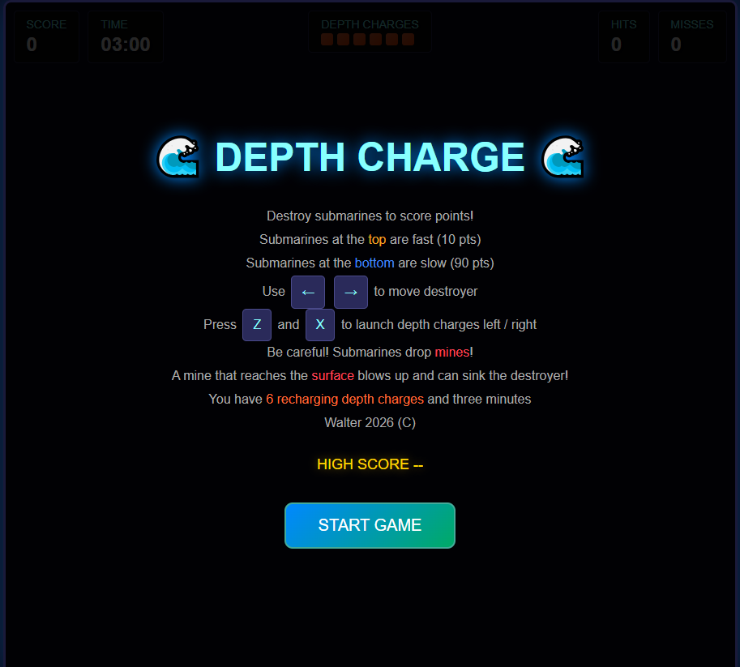
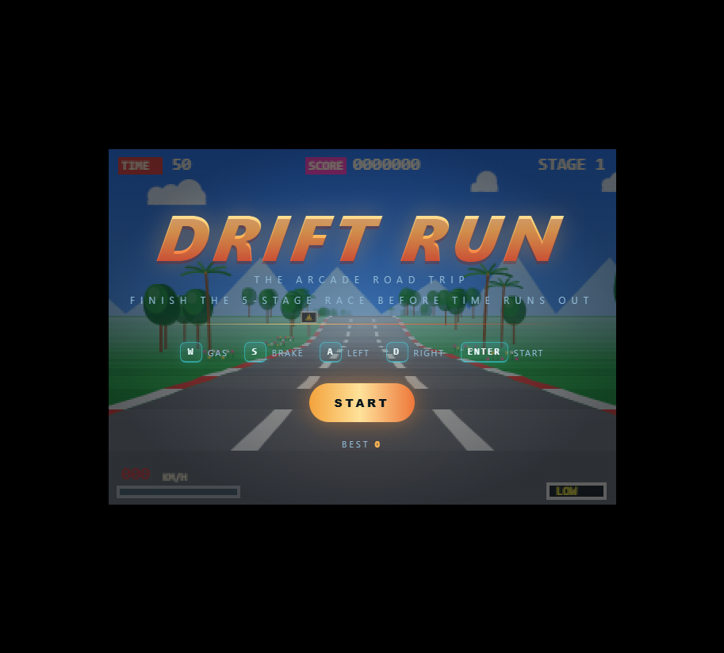
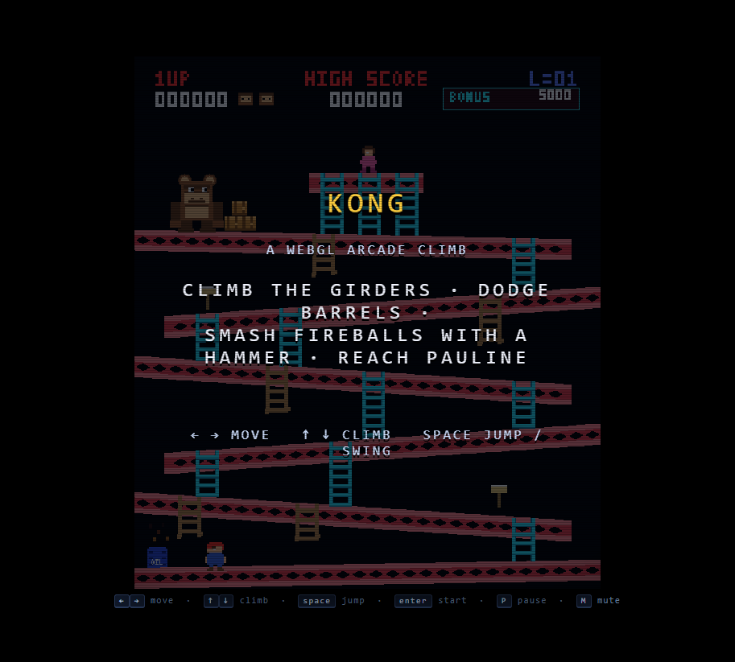
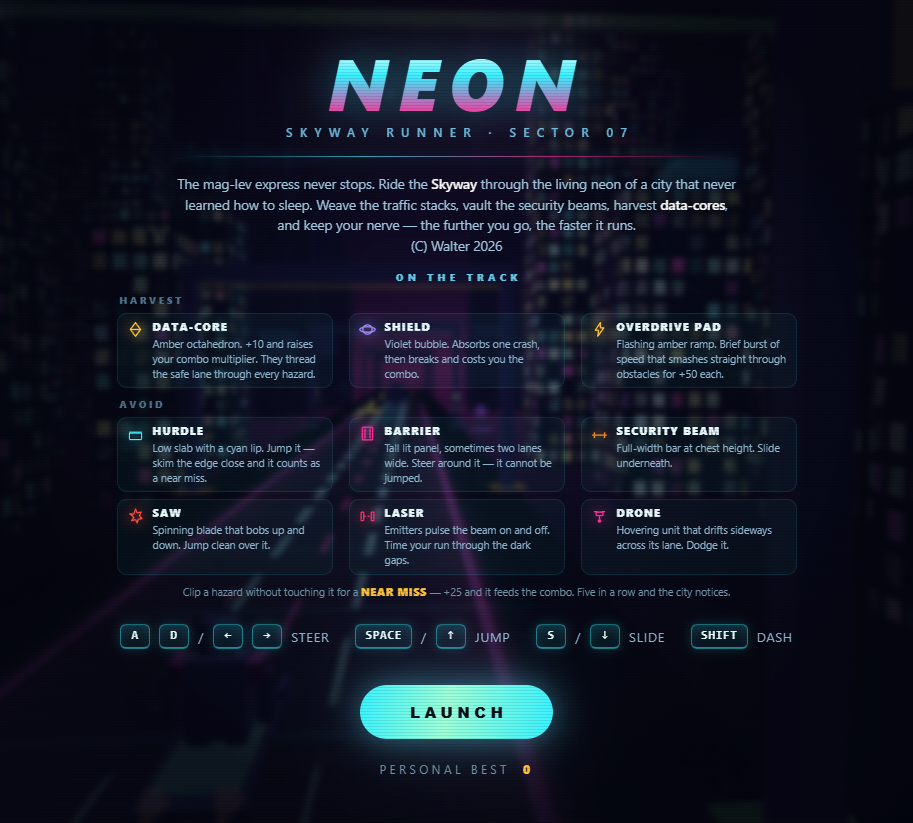
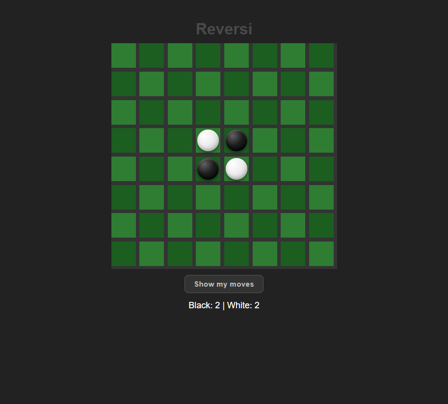
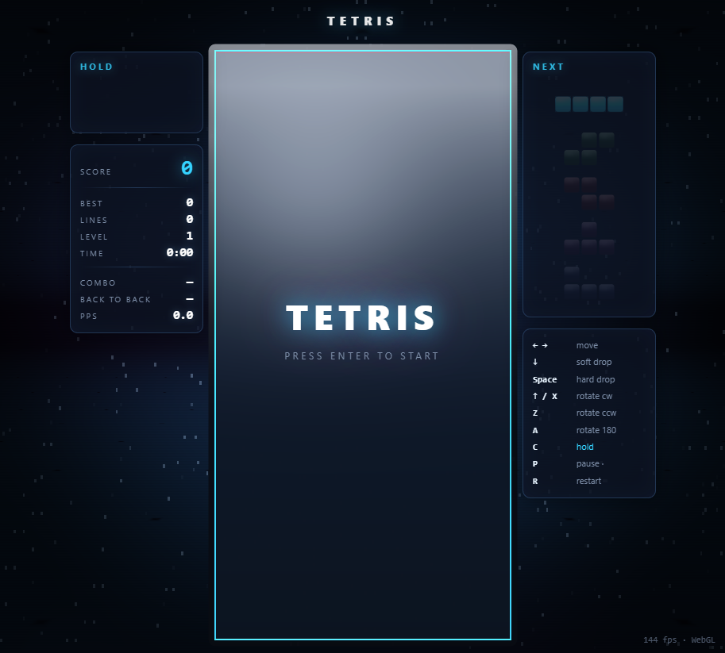

# Web Games

A collection of browser games created in javascript with the help of AI. Each game is a self-contained HTML page, so you can play it locally without installing dependencies or running a server: open the linked page in a modern browser.

## Games

### Depth Charge

Hunt submarines in a timed arcade action game. Fast submarines near the top are worth fewer points; slower ones near the bottom are worth more. Avoid mines and make the most of your recharging charges.

- **Move:** Left / Right arrow keys
- **Fire:** `Z` (left) and `X` (right)
- **Play:** [Open Depth Charge](DepthCharge/DepthCharge.html)

### Drift Run

Race through five stages in a pseudo-3D arcade road trip. Finish each stage before time runs out and avoid traffic.

- **Gas / brake:** `W` / `S`
- **Steer:** `A` / `D`
- **Start:** `Enter`
- **Play:** [Open Drift Run](Driftrun/DriftRun.html)

### Kong

Climb the girders, dodge barrels, use the hammer against fireballs, and reach Pauline in this WebGL arcade platform game.

- **Move:** Left / Right arrows
- **Climb:** Up / Down arrows
- **Jump / swing:** `Space`
- **Start / pause / mute:** `Enter` / `P` / `M`
- **Play:** [Open Kong](Kong/Kong.html)

### Neon

Dash along a neon skyway, weaving through traffic and hazards while collecting data-cores. The run gets faster the farther you go.

- **Steer:** `A` / `D` or Left / Right arrows
- **Jump:** `Space` or Up arrow
- **Slide:** `S` or Down arrow
- **Dash:** `Shift`
- **Play:** [Open Neon](Neon/Neon.html)

### Reversi

Play Reversi on an 8×8 board against the computer. Place a disc to trap and flip your opponent's discs; the player with the most discs when the game ends wins. Click a square to place a disc, and use **Show my moves** to reveal your legal moves.

- **Play:** [Open Reversi](Reversi/Reversi.html)

### Tetris

Fit falling pieces together to clear lines, build combos, and improve your score.

- **Move:** Left / Right arrows
- **Soft / hard drop:** Down arrow / `Space`
- **Rotate:** Up arrow or `X` (clockwise), `Z` (counter-clockwise), `A` (180°)
- **Hold / pause / restart:** `C` / `P` / `R`
- **Start:** `Enter`
- **Play:** [Open Tetris](Tetris/Tetris.html)

